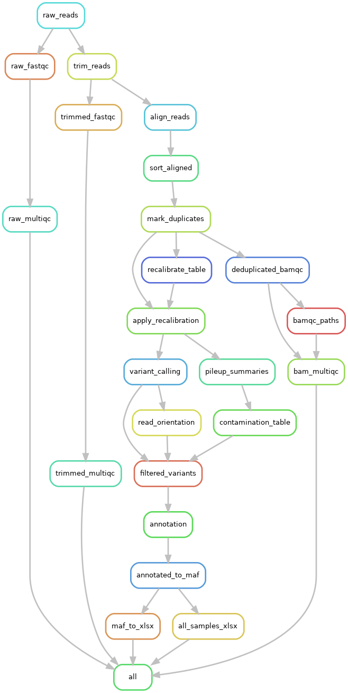

# twist_myeloid_lymphoid
Repository for the analysis pipeline on the Twist Myeloid-lymphoid panel

### What is in there:
  - shell scripts to download raw fastq and bcl files
  - shell script to convert bcl files to fastq files if needed
  - a complete Snakemake workflow
  - individual shell and R scripts for seaparate parts of the analysis

## Preparing files
### Downloading fastq or bcl files
To download fastq files, a shell script is already prepared to make it easier. 
To use, bs auth must be set up beforehand, then project ID for the run:
```
/path/to/bs/bs list projects
```
Download fastq and download bcl scripts can be found in the code/bash_scripts folder.

```
bash downlowad_bcl.sh
bash download_fastq.sh
```
Both scripts will ask for 
- base working directory
- run number
- project ID.

Downloaded files will be stored in the raw_reads/run_number or bcl_files/run_number folder.

### Converting bcl files to fastq
It is possible to convert bcl files to fastq files. This requires a comma-delimited sample sheet containing sample names and index sequences.
Example sample sheet is provided in the repository (aml_all_example_SampleSheet.csv).

*IMPORTANT: contrary to setup on basespace, P5 indices are required in forward, and P7 indices in reverse orientation*

Sample sheet must be placed in the same bcl_files folder, with aml_all*SampleSheet.csv prefix.

Running bcl2fastq:
```
bash bcl2fastq.sh
```
The script asks for:
-  base working directory
-  run number

Successfully created fastq files will be stored in the raw_reads/run_number folder.

## Basic snakemake workflow


(nodes represent rules to create specific outputs)
## Running snakemake on raw_reads
The workflow has several built-in parameters:
- the workflow ignores undetermined and control files
- intermediate files will be deleted after each run to save space
- all results (including multiqc files) are saved in the tables/run_number folder
- remaining intermediate files: bam files from apply_recalibration rule, annotated vcf files from annotation rule

### Running all rules for all files in a run
When running this workflow, certain things need to be specified in the command line:
```
snakemake --cores 4 --directory /base/working/directory --config run=run_number --configfile config.yaml
```

- cores: the number of cores specified for the run. Since it runs some jobs parallel, more cores results in less runtime, but takes up more resources.
- directory: working directory for analysis.
- config: specifying analysis run number (e.g. run=run_30)
- configfile: .yaml file containing necessary files and paths for analysis tools. In case a file needs to be replaced (like a bed file), it should be changed here.

To save intermediate files in the run as well, the --notemp flag can be added. This is useful when re-running missing samples. Afterwards, retyping with the --delete-temp-output flag removes all temp files in the run.

Threads can be defined under --config (e.g. threads=4). If not defined, the pipeline runs with default 4.

### Running sections of snakemake:
It is possible to run a single sample by specifying the desired output:
```
snakemake --cores 4 --directory /base/working/directory --configfile config.yaml path/to/output/sample.bam
```
*note: snakemake only recognises the output file if it matches the name it should create exactly*

It is also possible to run only up to a specified rule:
```
snakemake --cores 4 --directory /base/working/directory --configfile config.yaml align_reads
```
This will run snakemake only until the output files of the align_reads are created.

## Shell script containing the entire pipeline
*It is not advised to use this, this is a last resort if Snakemake doesn't work at all*

In code/bash_scripts the twist_complete_pipeline.sh produces the same outputs as the snakemake workflow.
Running the script:
```
bash twist_complete_pipeline.sh
```
The script will ask for:
- base working directory
- run number

This script will NOT generate log files, if it fails it re-runs and overwrites everything (unless lines are commented out) and it will take much longer as it does not parallelise jobs.
